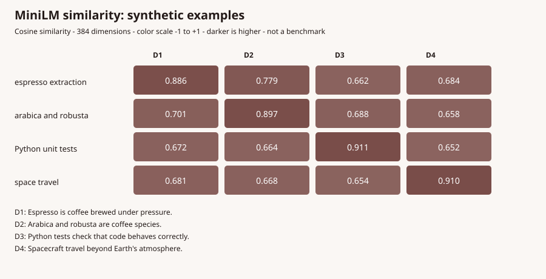

# Model selection, retrieval, hardware and desktop isolation

This document describes the current implementation and its limits. Tables marked
**qualitative** are architectural comparisons, not benchmarks. Local measurements
below are identified separately; model accuracy, latency and security are not inferred
from model size or an attractive heatmap.

## The roles are different

| Family / example | Role | What it can and cannot establish |
| --- | --- | --- |
| Liquid LFM2.5 230M / 350M | Small generative models | Produce text and, if supported by the integration, structured tool calls. Small size reduces resource requirements, but makes complex reasoning, precise tool use and following long instructions harder. |
| LFM2.5 1.2B Instruct / Thinking | Generative models | Instruct and Thinking are distinct trained variants; Thinking may emit intermediate reasoning. Neither guarantees correctness. |
| LFM2.5 2.6B / 8B-A1B | Larger generative models | Higher memory and load cost. 8B-A1B is a mixture-of-experts model: active parameters per token differ from total stored parameters. Runtime and quality must be measured. |
| LFM2.5 VL 450M / VL 3B | Vision-language generation | Accept visual input through compatible preprocessing/projector configuration. They are not text-only models with magically added image understanding. |
| LFM2.5 Audio 1.5B | Audio-oriented generation | Needs the matching runtime, projector and, where required, vocoder. A model file alone does not prove an audio path works. |
| MiniLM-L6-v2 | Embedding encoder | Maps text to a 384-dimensional vector for similarity search. It does not generate answers or increase another model's parameters or reasoning ability. |
| Gemma / Qwen | Separate model families | Alternative generative architectures/training and licensing; exact sizes, quantization, multimodal support and quality depend on the specific artifact. They are not currently in this desktop Playground router's LFM-only preset list. Other repository services or historical documentation may refer to them. |
| Granite 4.2 | Spectre generation | Used by the separately configured Spectre stack; do not assume it is available as a Playground model. |

The currently configured Playground router exposes six LFM text variants, two LFM
vision variants and one LFM audio variant. MiniLM is a separate embedding service.
Check the actual UI entitlement, model files, license and runtime capability rather
than assuming every model mentioned in the repository is available to every user.

## Heatmaps: how to read them

An embedding similarity heatmap places documents on one axis and queries on the other;
each cell is a measured cosine similarity `dot(q,d) / (norm(q)*norm(d))`. Brighter
cells indicate closer vectors, **not** truth, causal importance, quality or authorization.
Display the model/index version, labels, sample count, color scale and missing values.
Normalize and exclude zero or non-finite vectors before calculating similarities. An
attention heatmap is different: its cells depict a model layer/head's attention weights;
attention is not a reliable standalone explanation of causality.

This figure was generated locally using the configured MiniLM GGUF, eight fixed
synthetic texts and `scripts/generate_minilm_heatmap.py`. Cells are measured cosine
similarities, not answers or attention weights. The model ranks each deliberately
related document highest for these four hand-picked queries; this tiny, non-blind
example is **not a benchmark**, does not establish retrieval accuracy for the coffee
database, and may differ with another model, tokenizer or pooling configuration.
Color uses the full -1 to +1 scale. Reproduce it in a trusted environment with the
embedding endpoint available, e.g. `python scripts/generate_minilm_heatmap.py > heatmap.svg`.
The table below is a conceptual categorical comparison, not a measured heatmap.

| Qualitative resource heatmap | Parameter storage | Context/KV pressure | Additional component |
| --- | --- | --- | --- |
| MiniLM encoder | Low | Sequence-dependent | Separate embedding service and vector index |
| LFM 230M Q4 | Low | Can grow substantially with context and slots | Chat runtime |
| LFM 1.2B Q4 | Medium | Can grow substantially | Chat runtime |
| LFM 8B-A1B Q4 | High | Can grow substantially | CPU expert offload may be needed |
| LFM VL / Audio | Varies by variant | Varies with input and context | Projector; audio may also need vocoder |

Suggested **measured** evaluation: freeze a query/document set and labels; produce a
similarity heatmap for retrieval plus Recall@k and MRR; separately score answer support,
answer correctness, refusals, tool-call validity, latency, memory, and token/cost usage.
Report model and GGUF hash, corpus/index version, hardware, context, quantization,
sampling, warm/cold state, number of repetitions, errors and confidence intervals. A
better retrieval score does not necessarily imply a better answer from the 230M model.

## RAG: Kafelot versus general Playground

Kafelot natural-language coffee questions use a bounded coffee-fact retrieval path:

1. Embed the question using the separately hosted MiniLM llama.cpp embedding endpoint.
2. Compare against the **same versioned embedding space** for `coffee_facts` with
   PostgreSQL/pgvector cosine distance; discard stale entries whose fact text changed.
3. Pass the selected facts as context to the selected generator. The generator, not
   MiniLM, composes the answer; context is untrusted data, not system instructions.
4. If embeddings, the versioned index or database query are unavailable, use the
   existing lexical fallback and report its actual retrieval mode.

The existing `coffee_facts.embedding` values have unknown model provenance. They are
not silently mixed with new MiniLM vectors. `coffee_fact_embeddings` stores a separate
index keyed by fact and `MINILM_INDEX_ID`; the explicit reindexer does not delete or
rewrite facts or the old vectors. Changing model weights, tokenizer, preprocessing or
pooling requires a **new identifier and a complete reindex**. The default identifier
names the locally inspected GGUF hash prefix `5a30b84d`; verify the actual artifact and
pooling before using it. The system does not independently attest the remote server's
model hash, so an incorrectly configured endpoint can still produce an incompatible
index. Back up the database and have its owner apply
`nestjs-backend/data/migrate_coffee_fact_embeddings.sql`. Grant the configured AI
service role only `SELECT, INSERT, UPDATE` on `coffee_fact_embeddings` for indexing
(or run indexing under a distinct maintenance role and grant the serving role only
`SELECT`). Do not grant write access to `coffee_facts`. Then run
`python reindex_coffee_embeddings.py --apply` in the configured AI environment.
The transaction rolls back on an encoding or concurrent-fact-change failure. A partly
indexed corpus may return incomplete results; monitor coverage and rebuild on changes.

This path is **not** automatically injected into general Playground conversations:
coffee facts would be irrelevant to many programming or research questions. A general
agent RAG feature would need explicit user/source selection, ingestion consent, ACLs,
account-scoped indexing and deletion, citation/provenance, prompt-injection handling,
and a token/context budget. Do not embed private projects or web queries into a shared
index without that design. RAG cannot guarantee groundedness or fix a weak model's
reasoning; use held-out tasks and compare with/without retrieval.

## Hardware and quantization

The examined development machine reports an NVIDIA RTX 3050 Ti Laptop GPU with
4096 MiB VRAM, driver 591.44. This is a dated local observation, not a requirement or
a performance guarantee. The checked local files measure approximately 0.14 GiB for
LFM 230M Q4_K_M, 0.68 GiB for LFM 1.2B Q4_K_M, 1.48 GiB for 2.6B Q4_0,
4.80 GiB for 8B-A1B Q4_K_M and 0.02 GiB for MiniLM GGUF. Vision/audio projectors,
vocoder, runtime allocations, GPU drivers, other services, batch buffers and context
cache consume additional memory. File size is **not** peak VRAM. The router declares
128K context, one resident chat model and four server slots; its gateway limits model
admission. A declared 128K setting is not proof that every workload fits or preserves
quality. Offload and model swaps can use system RAM and increase latency.

Quantization trades numerical fidelity for smaller storage and potentially faster
inference. Q4_K_M, Q4_0 and Q8_0 are different formats; a larger model at lower
precision is not automatically better or faster. Evaluate the exact conversion and
task. For 4 GiB VRAM, reserve headroom and test realistic input/output lengths and
concurrent requests; fall back explicitly on resource exhaustion rather than making
unsupported throughput claims.

## Safetensors, ONNX and GGUF; llama.cpp and Ollama

Safetensors is a tensor **storage format**, not an inference engine: typically a
Transformers/PyTorch or other compatible runtime must load the architecture,
tokenizer, weights and device libraries. ONNX is a computation-graph format normally
run by ONNX Runtime or another compatible backend, with execution providers and
operator support determining acceleration. GGUF packages quantized tensors and model
metadata for compatible runtimes such as llama.cpp; conversion quality and supported
architectures matter. File extension alone does not prove compatibility, safety,
licensing, performance or identical outputs.

Filspresso uses llama.cpp because the existing integration already has a GGUF server,
an OpenAI-compatible API, explicit router presets, model residency control and a
small GPU/offload deployment model. Ollama is a valid alternative with model lifecycle
and user-facing tooling, and may itself use llama.cpp-derived components. Choosing
llama.cpp here is an integration/control decision, **not** a demonstrated universal
speed or quality advantage. A fair comparison would pin versions, model conversion,
quantization, prompts, context, hardware, concurrency and load state, then measure
quality, throughput, latency, RAM/VRAM and operational complexity.

## Desktop: VM and explicit native fallback

Windows Sandbox is the preferred separate-kernel VM. The application does not share
the original project directory; it seeds a bounded staged text copy, treats guest
output as untrusted and requires a machine/build/package-specific live receipt. On the
examined Windows update, the guest AppContainer PowerShell qualification probe failed
with `0xC0000142`; no VM receipt was issued. The share-transport changes and component
tests are not a substitute for passing the entire VM qualification.

When VM setup, qualification or startup is unavailable, the UI can offer a separately
qualified native restricted backend after explicit confirmation. The implementation
uses an AppContainer, filesystem ACLs, private desktop, Job Objects, a scrubbed
environment and offline staged workspace. It shares the host Windows kernel and can
read some public/system resources. This is a **Codex-like restricted-process design**,
not the same implementation, not Codex MXC, not a VM, and not protection against a
compromised kernel or privileged host process. Both backends require fresh exact-action
approval, bounded output, lifecycle/recovery checks and reviewed export. If cleanup is
uncertain, execution remains blocked. Plan is currently read-only; isolated Plan
execution and non-apply across mode transitions remain pending.

The native fixed checks passed on the examined device, including the packaged qualifier;
that does not prove every installed version or OS update safe, nor does it qualify the
VM. MSI install/upgrade/uninstall and the complete UI fallback interaction still need
end-to-end verification. See [Windows Sandbox details](playground-windows-sandbox.md).

## References and reproducibility

- llama.cpp server and GGUF: <https://github.com/ggml-org/llama.cpp>
- Ollama documentation: <https://docs.ollama.com/>
- pgvector cosine distance: <https://github.com/pgvector/pgvector>
- Sentence Transformers semantic search: <https://www.sbert.net/examples/sentence_transformer/applications/semantic-search/README.html>
- ONNX Runtime: <https://onnxruntime.ai/docs/>; safetensors: <https://huggingface.co/docs/safetensors/>
- Microsoft AppContainer: <https://learn.microsoft.com/windows/win32/secauthz/appcontainer-isolation>
- OpenAI's Windows sandbox design: <https://openai.com/index/building-codex-windows-sandbox/>
- Project sources: `models/tanka.py`, `app.py`, `models/router-presets.ini`,
  `docker-compose.yml`, `reindex_coffee_embeddings.py`, and desktop sandbox code.
